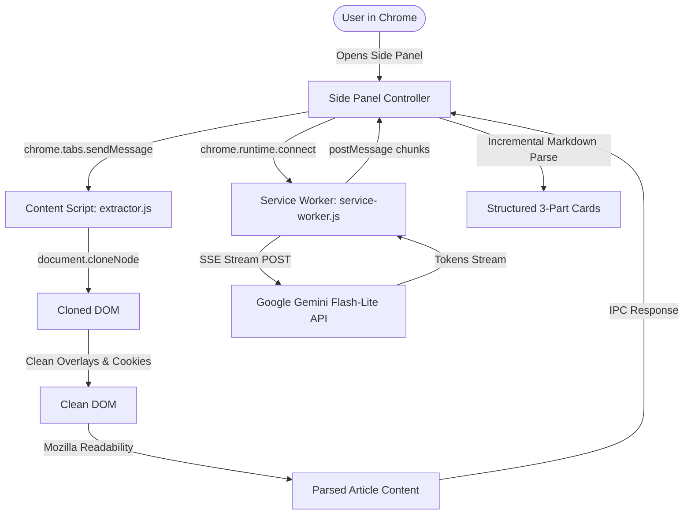

# Sahayak (सहायक) — Safe, Human-in-the-Loop AI Browser Assistant

[](https://developer.chrome.com/docs/extensions/mv3/intro/)
[](https://ai.google.dev/)
[](#privacy-and-security-guarantee)
[](LICENSE)

> **Sahayak (सहायक)** is an intelligent, privacy-first Chrome Side-Panel AI assistant designed to read, understand, and interact with the web alongside you. Powered by Google Gemini Flash-Lite and Mozilla Readability, it transforms complex web pages into structured insights, supports natural English & Hinglish communication, and follows a strict **Human-in-the-Loop (HITL)** architecture.

---

## 🌟 Core Philosophy: The Three Pillars

```text
       ┌─────────────────────────────────────────────────────────────┐
       │                 SAHAYAK ARCHITECTURE PILLARS               │
       └─────────────────────────────────────────────────────────────┘
                                      │
         ┌────────────────────────────┼────────────────────────────┐
         ▼                            ▼                            ▼
  👁️  THE EYES                🧠  THE BRAIN                 🤝  THE HANDS
  Content Extraction          Grounded Reasoning           Approved Action
  • Cloned DOM Readability    • Zero Hallucination         • Interactive Element Map
  • Ads & Noise Stripping     • Multimodal Vision          • Visual Action Badges
  • Paywall / SPA Defenses    • Bilingual (EN / Hinglish)  • Human Approval Required
```

1. **The Eyes (Read & Extract)**: Clones the active tab's DOM to extract noise-free article text without mutating the page or leaking state.
2. **The Brain (Understand & Ground)**: Operates strictly within XML-delimited untrusted web boundaries, preventing prompt injections and hallucinations while streaming responses via low-latency Server-Sent Events (SSE).
3. **The Hands (Act with Approval)**: Scans interactive elements, renders non-invasive numbered badges, and proposes single deterministic actions requiring explicit user confirmation before executing.

---

## 🚀 Key Features

### 📌 Structured 3-Part Summarization

Extracts any article, blog, documentation, or news story into three distinct, actionable cards:

* **📌 TL;DR**: 1–2 crisp, impactful sentences capturing the core thesis.
* **💡 Key Insights**: Exactly 5 distilled takeaways and data points.
* **🚀 Next Steps & Actionable Takeaways**: 2–3 practical recommendations for the reader.

### 🌐 Bilingual Dialect Toggle (English & Hinglish)

Switch seamlessly between standard **English** and natural, conversational **Hinglish** (Hindi grammar written in Latin script retaining standard technical terminology, e.g., *"Yeh article explain karta hai ki microservices architecture kaise scale hoti hai..."*).

### ⚡ Ultra-Low Latency Streaming UI

Real-time typewriter streaming via Chrome's native streaming port (`sahayak-stream-port`) connected directly to Google's REST streaming API (`gemini-flash-lite-latest`), delivering full summaries in ~2 seconds.

### 🛡️ Production Web Edge-Case Defenses

* **Single-Page Application (SPA) Retries**: 5-step polling loop with mutation detection for hydrating Next.js, React, and Substack pages.
* **Paywall & Subscription Awareness**: Heuristically detects gated articles and extracts available preview content with user alerts.
* **Token Budget Safeguards**: Automatically condenses long documents (>18,000 words) using hierarchical head/section/tail chunking.
* **Anti-Prompt Injection Guardrails**: Isolates page text inside `<<<UNTRUSTED_WEB_PAGE_CONTENT>>>` XML boundaries.

---

## 🏗️ System Architecture



---

## 📦 Project Structure

```text
Own AI Browser/
├── manifest.json              # Chrome Extension Manifest V3 configuration
├── .gitignore                 # Excludes .env, local credentials, and build caches
├── assets/
│   └── icons/                 # Extension toolbar and webstore icons (16, 48, 128px)
├── doc/                       # Reference architecture & planning documents
│   ├── ProblemStatement.md    # Product requirements and technical foundation
│   ├── architecture.md        # IPC contracts, state machine, and threat model
│   ├── implementation-plan.md # 4-Phase, 16-slice progressive engineering plan
│   └── edge-case.md           # Failure modes and deterministic mitigations catalog
└── src/
    ├── background/
    │   ├── service-worker.js  # MV3 Background worker, side panel lifecycle & port router
    │   └── ai-orchestrator.js # Direct REST client for Gemini with streaming & backoff
    ├── content/
    │   ├── readability.js     # Bundled Mozilla Readability + isProbablyReaderable
    │   └── extractor.js       # Cloned DOM content extraction & paywall/SPA defenses
    ├── shared/
    │   ├── constants.js       # Storage keys, models, IPC message types & defaults
    │   └── types.js           # Structured IPC message payload schemas
    └── sidepanel/
        ├── index.html         # Side panel UI layout (Summary, Chat, Agent, Settings)
        ├── sidepanel.css      # Dark mode design system & micro-animations
        ├── sidepanel.js       # Side panel controller & preferences manager
        ├── components/
        │   └── summary-view.js # Article summarizer view, streaming renderer & clipboard
        └── lib/
            └── readability.js # Readability module for sidepanel operations
```

---

## 🛠️ Quick Start & Installation

### Prerequisites

* Google Chrome (Version 116+ for Chrome Side Panel API support).
* A free **Google Gemini API Key** from [Google AI Studio](https://aistudio.google.com/app/apikey).

### Step 1: Clone or Open the Repository

```bash
git clone https://github.com/kasturimaheshbabu2316-mc/own-web-browser.git
cd own-web-browser
```

### Step 2: Load Extension in Chrome

1. Open Google Chrome and navigate to:

   ```text
   chrome://extensions/
   ```

2. Enable the **"Developer mode"** toggle in the top-right corner.
3. Click the **"Load unpacked"** button in the top-left corner.
4. Select the project folder (`Own AI Browser`).

### Step 3: Configure Your API Key

1. Click the puzzle icon (🧩) in Chrome's toolbar and open **Sahayak - AI Browser Assistant**.
2. Go to the **Settings** tab.
3. Paste your free Gemini API Key and click **Save Settings** (or click **Test Connection** to verify live latency).
4. You are ready! Navigate to any article and click **"Summarize Page"**.

---

<a id="privacy-and-security-guarantee"></a>

## Privacy and Security Guarantee

* **100% Local-First Storage**: API keys and preferences are stored exclusively on your device using `chrome.storage.local`.
* **Zero Middleman Servers**: Requests go directly from your browser to Google's official Gemini endpoint. There is no telemetry, tracking, or proxy server.
* **No Secret Leaks**: `.env` and local configuration files are ignored by Git and never committed to source control.

---

## 🗺️ Roadmap & Phase Tracker

| Phase | Focus Area | Status | Deliverables |
| :--- | :--- | :---: | :--- |
| **Phase 1** | **The Eyes: Read & Extract** | 🟡 In Progress | MV3 Shell, Gemini Streaming, Cloned Readability, 3-Part Summary, Hinglish Toggle |
| **Phase 2** | **The Brain: Ground & Understand** | ⚪ Planned | Grounded Page Chat, Context Menus (Explain/Draft), Screenshot-and-Ask, Groq Fallback |
| **Phase 3** | **The Hands: Approved Actions** | ⚪ Planned | Element Scanner, Numbered Badges, Proposal Cards, Human Confirmation Guard |
| **Phase 4** | **The Agent: Multi-Step Memory** | ⚪ Planned | Plan DAG Engine, Self-Correction Loop, User Profiling, Voice Input |

---

## 📚 Detailed Documentation

For in-depth technical specifications, please consult the documentation directory:

* 📄 [`doc/ProblemStatement.md`](doc/ProblemStatement.md) — Comprehensive technical challenge and solution design.
* 🏛️ [`doc/architecture.md`](doc/architecture.md) — IPC protocols, message types, state machine, and threat analysis.
* 📋 [`doc/implementation-plan.md`](doc/implementation-plan.md) — Detailed slice-by-slice roadmap.
* 🛡️ [`doc/edge-case.md`](doc/edge-case.md) — Comprehensive engineering catalog of 16+ edge cases and deterministic defenses.

---

## 📄 License

This project is licensed under the [MIT License](LICENSE).
