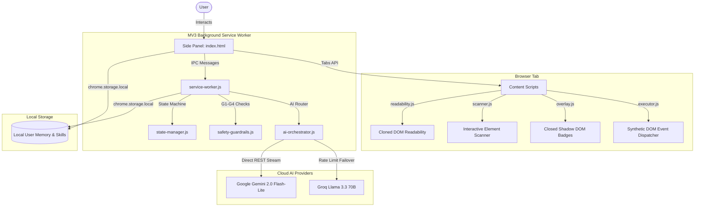

# Sahayak (सहायक) — Safe, Human-in-the-Loop AI Browser Assistant

[](https://developer.chrome.com/docs/extensions/mv3/intro/)
[](https://ai.google.dev/)
[](https://groq.com/)
[](#-privacy-and-security-guarantee)
[](LICENSE)
[](doc/implementation-plan.md)

> **Sahayak (सहायक)** is an autonomous, privacy-first Chrome Side-Panel AI assistant that **reads, understands, and acts with your direct approval**. Powered by Google Gemini Flash-Lite and Groq Llama 3.3, it turns complex webpages into structured insights, converses in English & colloquial Hinglish, and performs browser errands via a code-enforced **Human-in-the-Loop (HITL)** architecture with deterministic safety rails.

---

## 🌟 The Core Subsystems: 4 Vertical Pillars

```text
       ┌────────────────────────────────────────────────────────────────────────┐
       │                       SAHAYAK 4-PILLAR ARCHITECTURE                    │
       └────────────────────────────────────────────────────────────────────────┘
                                            │
        ┌───────────────────┬───────────────┴───────────────┬───────────────────┐
        ▼                   ▼                               ▼                   ▼
 👁️ THE EYES         🧠 THE BRAIN                    🤝 THE HANDS         🛡️ SAFETY & MEMORY
 Content Perception  Grounded Reasoning              Controlled Action    Deterministic Rails
 • Cloned DOM Read   • Page-Grounded Chat            • DOM Scanner        • Local Profile Memory
 • Noise & Ad Strip  • Multimodal Vision (Crop)      • Shadow DOM Badges  • 1-Click Skills Engine
 • YouTube Chapters  • Context-Menu AI Actions       • Single-Step HITL   • G1 Domain Blacklist
 • Bilingual Toggle  • Groq Circuit-Breaker Fallback • Dry-Run Mode       • G2 Field Quarantine
 (EN / Hinglish)     • Zero-Hallucination Gate       • Action Log JSON    • G3 Consequential Modal
                                                                          • G4 Esc Kill Switch
```

1. **The Eyes (Read & Extract)**: Clones the active tab's DOM to extract noise-free article text without mutating the page or leaking state.
2. **The Brain (Understand & Ground)**: Operates strictly within delimited web boundaries, preventing prompt injections and hallucinations while streaming responses via low-latency Server-Sent Events (SSE).
3. **The Hands (Act with Approval)**: Scans interactive elements, renders non-invasive numbered badges in an isolated Shadow DOM, and formulates single-step proposals requiring explicit human confirmation before executing.
4. **Memory, Safety & Rails**: Retains user profile memory locally, provides one-click prompt skills, and enforces code-level deterministic safety rails that block banking sites, quarantine credentials, and gate consequential mutations.

---

## 🚀 Complete Feature Walkthrough

### 👁️ Phase 1: The Eyes — Read the Web

* **📌 Structured 3-Part Article Summarization**:
  Extracts clean text using Mozilla Readability and formats it into three actionable cards:
  * **TL;DR**: 1–2 crisp sentences capturing the core thesis.
  * **Key Insights**: Exactly 5 distilled takeaways and data points.
  * **Next Steps**: 2–3 actionable recommendations for the reader.
* **🎥 YouTube Public Video Summarizer & Clickable Timestamps**:
  Automatically detects YouTube videos (`watch?v=*` and `/shorts/*`), extracts chapters/captions, and renders clickable `[MM:SS]` timestamp buttons. Clicking any timestamp dispatches an IPC seek command (`video.currentTime = seconds`) to immediately jump playback with an animated on-screen HUD.
* **🌐 Bilingual Dialect Toggle (English & Hinglish)**:
  Switch instantly using the top header segment control (`EN` / `Hinglish`). Hinglish produces conversational Hindi grammar written in Latin script while retaining all English technical terms (*"Yeh article explain karta hai ki microservices architecture kaise scale hoti hai..."*).

### 🧠 Phase 2: The Brain — Understand Page & Screen

* **💬 Grounded Page Chat Engine**:
  Conversational side panel chat strictly grounded in active page content. Features a strict negative constraint: queries about information not on the page are declined (*"I cannot find this information in the current page."*).
* **🖱️ Right-Click Context-Menu AI Actions**:
  Select text on any webpage and right-click to invoke:
  * `Sahayak: Explain this` — Simplifies jargon and clarifies context.
  * `Sahayak: Translate to Hindi / Hinglish` — Translates into conversational Hinglish.
  * `Sahayak: Draft a reply` — Generates quick and professional response options.
* **📷 Visual Multimodal Understanding (Capture & Ask)**:
  Captures the visible viewport, displays an HTML5 coordinate cropping modal, normalizes High-DPI / Retina pixel coordinates, and queries Gemini Vision to analyze infographics, charts, tables, and UI layouts.
* **🔄 Free-Tier Resilience & Groq Fallback Engine**:
  Zero-downtime operation for free-tier users. Automatically detects HTTP 429 rate limits or HTTP 503 server overloads, applies exponential backoff with jitter, and fails over to Groq's high-speed `llama-3.3-70b-versatile` endpoint.

### 🤝 Phase 3: The Hands — Act With User Approval

* **🎯 Interactive Element Scanner**:
  Scans buttons, inputs, links, and selects. Filters invisible elements and hidden inputs. Assigns sequential integer IDs (`#1`, `#2`, `#3`...) with 8-tier accessible label resolution.
* **🏷️ Numbered Badges in Closed Shadow DOM**:
  Renders visual badge pills anchored to targets inside `#sahayak-badge-host` with closed Shadow DOM (`mode: 'closed'`), guaranteeing zero style leakage, no page layout shifts, and scroll tracking.
* **🔍 "Find It For Me" Natural Language Locator**:
  Ask *"Where is the submit button?"* or *"Where do I enter my college?"*. Grounded AI returns target element ID, and content script smoothly scrolls to it with an amber glowing pulse ring.
* **🤖 Single-Step Human-in-the-Loop State Machine**:
  Task execution pauses in `AWAITING_APPROVAL` at every single step. Shows target element, action type, value to type, and AI reason. **Zero DOM mutations take place without user clicking [Approve]**.
* **⚙️ Synthetic DOM Execution & Safety Controls**:
  Dispatches framework-compliant synthetic events (React, Vue, Angular prototype value setters). Features configurable step limits (5/10/15), Dry-Run Mode (highlights without clicking/typing), and downloadable JSON Action Logs.

### 🛡️ Phase 4: Memory, Safety & Reusable Skills

* **👤 Local User Profile Memory & Smart Autofill (Slice 4.1)**:
  Stores Full Name, Email, Phone, College/Org, Graduation Year, Skills, Portfolio, LinkedIn, and GitHub 100% locally in `chrome.storage.local`. Errand *"Fill this form using my profile"* maps stored profile keys to form inputs for single-click approval. Includes demo data generator, practice autofill launcher, and JSON export/import.
* **⚡ One-Click Reusable Skills Engine (Slice 4.2)**:
  Pre-installed built-in skills:
  1. **Exam Revision Notes** — Formats definitions, core theories, and 3 practice quiz questions.
  2. **Explain in Hinglish** — Translates concepts into colloquial Hindi-English with analogies.
  3. **Polite Email Reply** — Drafts professional, courteous reply.
  4. **Autofill Form from Profile** — Direct agent errand mapping.
  Custom skill drawer allows creating, editing, deleting, exporting (`sahayak-skills.json`), and importing skills with conflict-free merging.
* **🔒 Deterministic Safety Guardrail Engine (Slice 4.3)**:
  Four code-enforced guardrails that protect the user without relying on model judgment:
  * **Guardrail 1 (Restricted Domain Blacklist)**: Rejects execution on banking and payment sites (`netbanking`, `hdfc`, `sbi`, `icici`, `paypal`, `stripe`, `razorpay`, `paytm`, `billdesk`) with a high-visibility security banner.
  * **Guardrail 2 (Protected Field Quarantine)**: Automatically strips `type="password"`, `autocomplete="current-password"`, `autocomplete="one-time-code"`, and fields matching `/(otp|cvv|cardnumber|pin|ssn|passcode)/i`.
  * **Guardrail 3 (Consequential Action Gate)**: Actions targeting `Submit`, `Pay Now`, `Order`, `Delete`, or `Transfer` trigger a high-visibility red modal requiring secondary confirmation.
  * **Guardrail 4 (Immediate Kill Switch)**: Pressing `Esc` or clicking the sticky red **Emergency Stop** button instantly halts the running task and clears badges.

---

## 🏗️ System Architecture



---

## 📦 Project Directory Structure

```text
Own AI Browser/
├── manifest.json              # Chrome Extension Manifest V3 specification
├── .gitignore                 # Excludes .env, build artifacts, and release ZIPs
├── LICENSE                    # MIT License
├── README.md                  # Comprehensive technical documentation
├── docs/                      # GitHub Pages static landing site
│   └── index.html             # Responsive single-page showcase
├── scripts/
│   └── package-release.js     # Production release packager
├── assets/
│   ├── icons/                 # Extension toolbar & store icons (16, 48, 128px)
│   └── practice/              # Safe sandbox practice testbeds
│       └── internship-form.html # Standard practice form testbed
├── doc/                       # Architecture & specification documents
│   ├── ProblemStatement.md    # Product requirements and technical foundation
│   ├── architecture.md        # IPC contracts, state machine, and threat model
│   ├── implementation-plan.md # 4-Phase, 17-slice progressive engineering plan
│   └── edge-case.md           # Failure modes and deterministic mitigations catalog
└── src/
    ├── background/
    │   ├── service-worker.js  # MV3 Service Worker lifecycle & IPC router
    │   ├── state-manager.js   # Human-in-the-Loop agent state machine
    │   ├── safety-guardrails.js # G1-G4 deterministic safety rail engine
    │   ├── context-menu.js    # Selection context menu registration & router
    │   └── ai-orchestrator.js # Direct REST client for Gemini & Groq fallback
    ├── content/
    │   ├── readability.js     # Bundled Mozilla Readability
    │   ├── extractor.js       # Cloned DOM content extraction & defenses
    │   ├── youtube.js         # YouTube chapters, transcripts & seeking
    │   ├── scanner.js         # Interactive element scanner & quarantine
    │   ├── overlay.js         # Closed Shadow DOM badges & amber glow pulse
    │   └── executor.js        # Synthetic DOM event execution engine
    ├── shared/
    │   ├── constants.js       # Storage keys, models, IPC types & skills
    │   ├── types.js           # Structured IPC request/response schemas
    │   └── env.example.js     # Local development environment template
    └── sidepanel/
        ├── index.html         # 6-Tab Side Panel layout (Summary, Chat, Agent, Skills, Profile, Settings)
        ├── sidepanel.css      # Dark mode design system & micro-animations
        ├── sidepanel.js       # Side panel controller & tab router
        └── components/
            ├── summary-view.js # Article summarizer view & clipboard controls
            ├── chat-view.js    # Grounded page chat, vision cropping & chips
            ├── agent-view.js   # Element scanner, HITL proposal card & kill switch
            ├── profile-view.js # Local user profile memory & autofill manager
            └── skills-view.js  # Reusable skills engine & JSON import/export
```

---

## 🛠️ Installation & Setup

### Option A: Load Unpacked in Chrome (Recommended for Developers)

1. **Clone the repository**:
   ```bash
   git clone https://github.com/kasturimaheshbabu2316-mc/own-web-browser.git
   cd own-web-browser
   ```

2. **Open Chrome Extensions**:
   Navigate to `chrome://extensions/` in Google Chrome.

3. **Enable Developer Mode**:
   Toggle the **Developer mode** switch in the top-right corner.

4. **Load Unpacked**:
   Click **Load unpacked** in the top-left corner and select the project folder (`Own AI Browser`).

5. **Configure API Key**:
   * Click the Sahayak icon in the Chrome toolbar to open the Side Panel.
   * Switch to the **Settings** tab.
   * Paste your free [Google Gemini API Key](https://aistudio.google.com/app/apikey).
   * *(Optional)* Paste a [Groq API Key](https://console.groq.com) for zero-downtime free-tier failover.
   * Click **Save Settings** (or **Test Connection** to measure live latency).

---

### Option B: Install from Release ZIP Package

1. Download the latest `sahayak-ai-browser-v1.0.0.zip` from [Releases](https://github.com/kasturimaheshbabu2316-mc/own-web-browser/releases).
2. Extract the ZIP into a local folder.
3. Open `chrome://extensions/`, enable **Developer mode**, click **Load unpacked**, and select the extracted folder.

---

## 🧪 Safe Practice Testbed

Sahayak includes a local sandbox form for practicing browser automation with zero risk:

1. Open the Side Panel and click **Agent** tab.
2. Click **Practice Form** in the top banner (or open `assets/practice/internship-form.html`).
3. Click **Profile** tab, click **⚡ Demo Data**, and click **Save Profile**.
4. Return to **Agent** tab, click the **Fill from profile** chip, and click **Start Errand**.
5. Approve each proposal step-by-step to watch Sahayak fill the form safely with your approval!

---

## 🔒 Privacy and Security Guarantee

* **100% Local-First Storage**: User profiles, custom skills, and API credentials reside strictly in `chrome.storage.local` on your physical machine.
* **Direct REST API Calls**: No intermediary backend servers or proxy services. Browser requests travel directly from Chrome to Google's official Gemini endpoint.
* **Deterministic Guardrails**: Financial domains (HDFC, SBI, PayPal, Stripe, etc.) and credential fields (passwords, OTPs, CVVs) are blocked at the code level, completely independent of model judgment.
* **Human Approval Gate**: Zero DOM clicks or typing occur without explicit user confirmation.

---

## 🗺️ Roadmap & Verification Matrix

All 4 Phases (17 Slices) are **100% complete and verified**:

| Verification Target | Expected Behavior | Status |
| :--- | :--- | :---: |
| **Clean Installation** | Unpacks without manifest or permission warnings in Chrome | ✅ Passed |
| **API Credential Security** | Stored in `chrome.storage.local`; omitted from source/repo | ✅ Passed |
| **Article Summarization** | Outputs TL;DR, 5 points, next steps from Readability.js | ✅ Passed |
| **YouTube Navigation** | Generates chapter breakdown with functional timestamp seeking | ✅ Passed |
| **Bilingual Toggle** | Seamlessly alternates between English and colloquial Hinglish | ✅ Passed |
| **Grounded Page Chat** | Answers strictly from page context; declines ungrounded queries | ✅ Passed |
| **Context Menu Actions** | Right-click triggers Explain, Translate, and Draft Reply | ✅ Passed |
| **Multimodal Vision** | Captures tab and correctly analyzes visual diagrams/charts | ✅ Passed |
| **Rate-Limit Resilience** | Retries with backoff and fails over to Groq free tier on 429 | ✅ Passed |
| **DOM Scanner & Badges** | Assigns stable numbers in closed Shadow DOM overlay | ✅ Passed |
| **Find It For Me** | Natural language query scrolls to and highlights target element | ✅ Passed |
| **Human-in-the-Loop Loop** | No DOM action occurs without user clicking "Approve" | ✅ Passed |
| **Safety Guardrails** | Blocks banking domains, password fields, and OTP inputs | ✅ Passed |
| **Consequential Action Gate** | Requires secondary confirmation for Submit/Pay buttons | ✅ Passed |
| **Profile Autofill** | Reuses local profile data to complete practice application | ✅ Passed |
| **Skills Management** | Built-in skills run in 1 click; custom skills export/import | ✅ Passed |
| **Release Packaging** | Clean distribution ZIP with automated packaging script | ✅ Passed |

---

## 📄 License

This project is open-source software licensed under the [MIT License](LICENSE).
