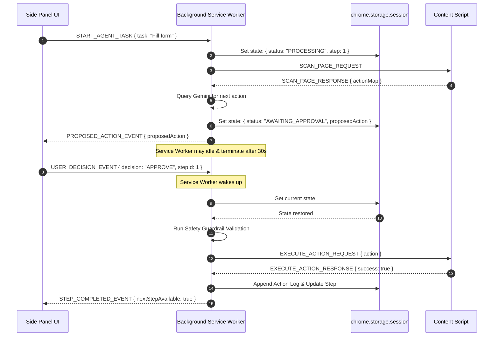
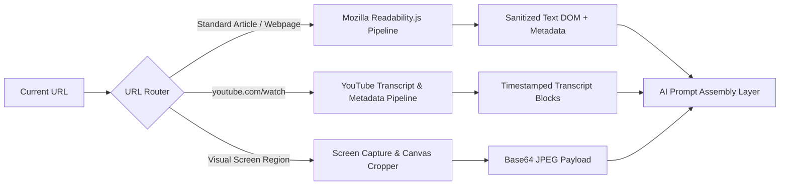
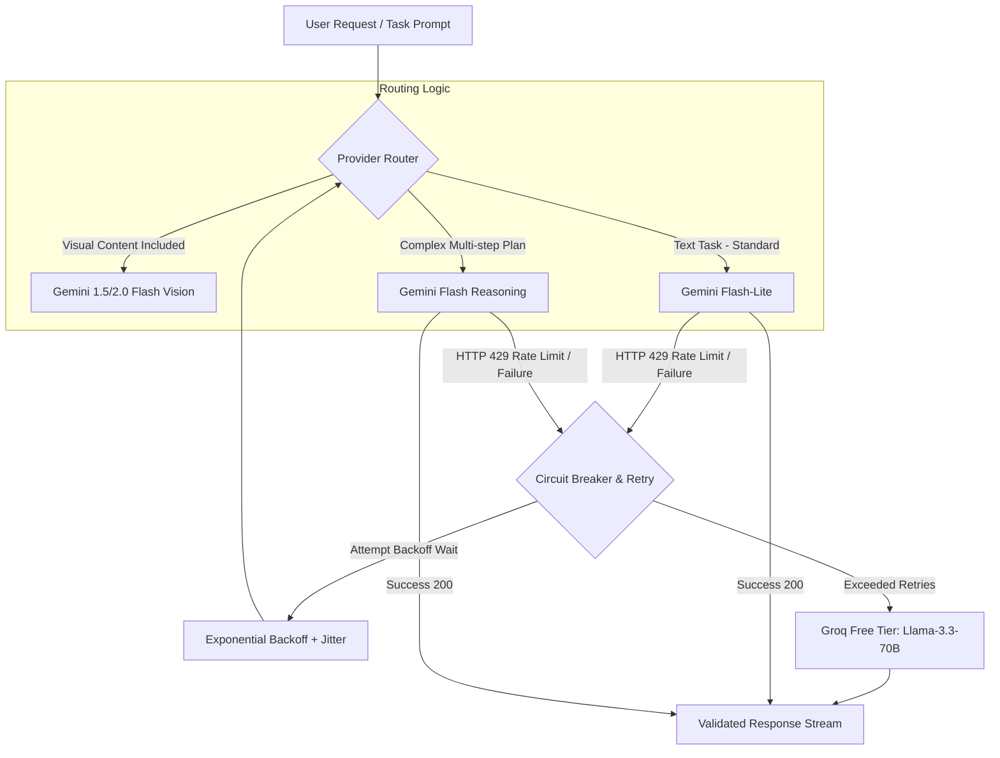
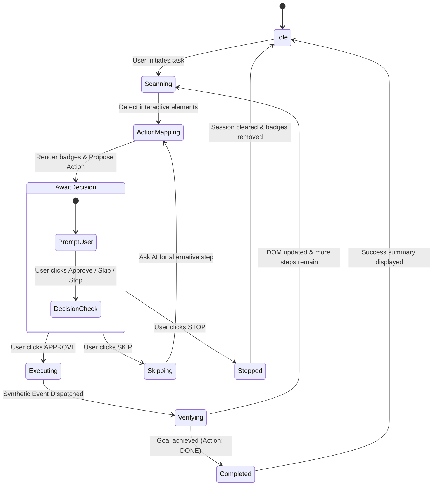
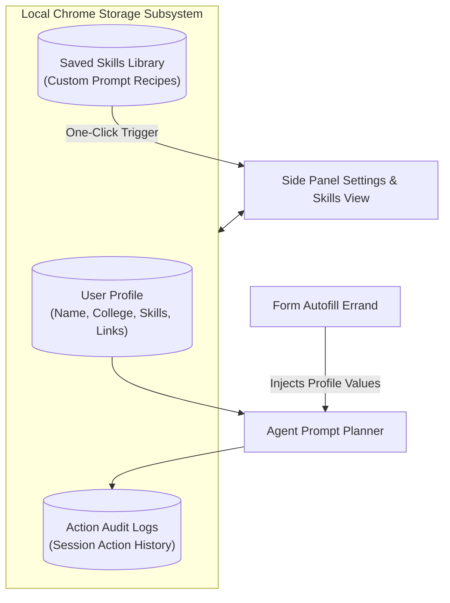
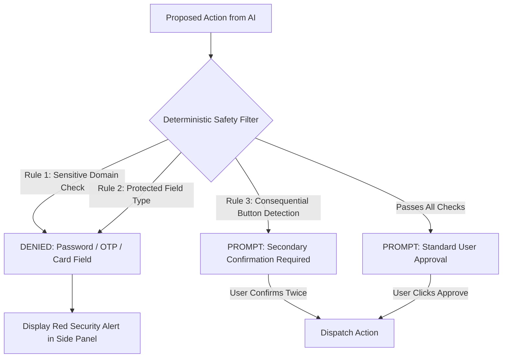

# Architecture Specification: Sahayak AI Browser Agent

> **Version**: 1.0.0  
> **Target Platform**: Google Chrome Extension (Manifest V3)  
> **Source Specification**: [`doc/ProblemStatement.md`](file:///c:/Users/kastu/Desktop/Own%20AI%20Browser/doc/ProblemStatement.md)  
> **Author**: Architecture & System Design Team  
> **Status**: Approved for Implementation

---

## 1. Executive Summary & Architectural Philosophy

**Sahayak** is a privacy-first, human-in-the-loop Chrome side-panel AI agent built on Chrome Extension Manifest V3 (MV3). Unlike autonomous web agents that execute multi-step automations black-box, Sahayak operates under strict human supervision: it perceives page context, synthesizes concise action plans, and requires explicit user consent before executing any browser mutation.

### Core Architectural Tenets

1. **Human-in-the-Loop Sovereignty**: No browser action (`click`, `type`, `select`, `submit`) is ever performed without direct user authorization. The agent proposes; the user disposes.
2. **Deterministic Safety over Probabilistic AI**: Safety rules (blocking banking domains, password fields, OTP inputs, card data) are enforced deterministically via local JavaScript guardrails, never delegated to model discretion.
3. **Local-First Privacy**: User profiles, saved skills, browsing history, and API keys are stored exclusively in `chrome.storage.local`. No proprietary remote backend is required.
4. **Manifest V3 Resilience**: State machines are designed to withstand Chrome Service Worker dormancy and termination cycles through atomic state snapshots stored in `chrome.storage.session` and `chrome.storage.local`.
5. **Free-Tier Economic Viability**: The multi-tier AI routing system defaults to free-tier models (Gemini Flash-Lite), intelligently escalates to vision/multimodal models (Gemini Flash), and falls back to Groq free-tier on rate limits (HTTP 429).

---

## 2. High-Level System Architecture

The following diagram illustrates the interaction between Chrome extension components, the webpage DOM, local storage, and external AI providers.

```mermaid
graph TB
    subgraph Browser Context ["Browser User Interface & DOM"]
        User(["User"])
        WebPage["Active Webpage DOM"]
        SidePanelUI["Sahayak Side Panel UI<br/>(HTML5 / Vanilla CSS / ES Modules)"]
    end

    subgraph ContentScriptContext ["Isolated Content Scripts"]
        Scanner["Interactive Element Scanner<br/>(DOM Walker & Filter)"]
        Overlay["Visual Action Overlay<br/>(Shadow DOM Badges)"]
        Executor["Action Dispatcher<br/>(Synthetic Event Trigger)"]
        Extractor["Content Extractor<br/>(Mozilla Readability.js)"]
    end

    subgraph ExtensionBackground ["MV3 Background Service Worker"]
        Router["IPC Message Router"]
        StateManager["Agent State & Session Manager"]
        SafetyEngine["Deterministic Guardrail Engine"]
        AIEngine["AI Provider Orchestrator<br/>(Gemini / Groq / Fallbacks)"]
        CaptureEngine["Tab Screen Capture API"]
    end

    subgraph StorageLayer ["Local Storage Subsystem"]
        LocalStore[("chrome.storage.local<br/>Profile, Keys, Saved Skills")]
        SessionStore[("chrome.storage.session<br/>Active Task, Action Map, Step State")]
    end

    subgraph ExternalServices ["External AI Providers (Free Tier)"]
        GeminiLite["Google Gemini Flash-Lite<br/>(Default Fast Reasoning & Chat)"]
        GeminiFlash["Google Gemini Flash<br/>(Multimodal Vision & Deep Tasks)"]
        GroqFallback["Groq Llama 3 API<br/>(Rate-Limit / 429 Fallback)"]
        YouTubeTranscript["YouTube Captions / API"]
    end

    %% User Interactions
    User -->|Views & Controls| SidePanelUI
    User -->|Browses & Inspects| WebPage

    %% UI to Background
    SidePanelUI <==>|Chrome Runtime Messaging / Port| Router

    %% Content Scripts to Background & DOM
    Router <==>|chrome.tabs.sendMessage| Scanner
    Router <==>|chrome.tabs.sendMessage| Extractor
    Router <==>|chrome.tabs.sendMessage| Executor
    Scanner -->|Calculates Bounding Rects| Overlay
    Overlay -->|Injects Non-invasive Badges| WebPage
    Executor -->|Dispatches Events| WebPage
    Extractor -->|Extracts Clean Text| WebPage

    %% Background Internals
    Router <--> StateManager
    Router <--> SafetyEngine
    Router <--> AIEngine
    Router <--> CaptureEngine

    %% State & Storage
    StateManager <--> SessionStore
    StateManager <--> LocalStore

    %% External APIs
    AIEngine -->|REST / SSE Streaming| GeminiLite
    AIEngine -->|REST Multimodal| GeminiFlash
    AIEngine -->|REST Text Fallback| GroqFallback
    AIEngine -->|HTTP Fetch| YouTubeTranscript
    CaptureEngine -->|chrome.tabs.captureVisibleTab| WebPage
```



---

## 3. Chrome Extension Manifest V3 (MV3) Subsystem

### 3.1 Permissions & Architecture Blueprint

```json
{
  "manifest_version": 3,
  "name": "Sahayak - AI Browser Assistant",
  "version": "1.0.0",
  "description": "Safe, human-in-the-loop AI browser assistant that reads, understands, and acts with user approval.",
  "permissions": [
    "sidePanel",
    "activeTab",
    "scripting",
    "storage",
    "contextMenus",
    "tabs"
  ],
  "host_permissions": [
    "https://generativelanguage.googleapis.com/*",
    "https://api.groq.com/*",
    "https://www.youtube.com/*"
  ],
  "background": {
    "service_worker": "src/background/service-worker.js",
    "type": "module"
  },
  "side_panel": {
    "default_path": "src/sidepanel/index.html"
  },
  "content_scripts": [
    {
      "matches": ["<all_urls>"],
      "js": ["src/content/content-bridge.js"],
      "run_at": "document_idle"
    }
  ],
  "action": {
    "default_title": "Open Sahayak Assistant"
  },
  "icons": {
    "16": "assets/icons/icon16.png",
    "48": "assets/icons/icon48.png",
    "128": "assets/icons/icon128.png"
  }
}
```

### 3.2 Service Worker Dormancy & State Hydration Pattern

Chrome MV3 service workers unload automatically after 30 seconds of inactivity. To prevent state loss during the approval-waiting phase:

1. **Active Task State Storage**: Every state transition is written to `chrome.storage.session` (in-memory persistent across SW restarts).
2. **Rehydration Lifecycle**: When an event wakes the Service Worker (e.g., user clicks "Approve" in the Side Panel or context menu action), `StateManager.hydrate()` restores the pending step, target element, and action plan.
3. **Connection Liveness**: The Side Panel maintains a long-lived `chrome.runtime.Port` (`sahayak-panel-port`) to the background script while open, resetting the idle timer during active interaction.



---

## 4. Inter-Process Communication (IPC) Protocol

Communication between Extension contexts adheres to a strict typed message envelope.

### 4.1 Message Envelope Schema

```typescript
export interface IPCMessage<T = unknown> {
  id: string;              // UUIDv4 for request-response correlation
  type: IPCMessageType;    // Enumerated message action type
  payload: T;              // Strongly-typed payload
  timestamp: number;       // Unix epoch milliseconds
  source: 'SIDEPANEL' | 'BACKGROUND' | 'CONTENT_SCRIPT';
}

export type IPCMessageType =
  // Perception & Reading
  | 'EXTRACT_READABLE_CONTENT'
  | 'SUMMARIZE_ARTICLE'
  | 'SUMMARIZE_YOUTUBE'
  | 'TRANSLATE_TEXT'
  | 'EXPLAIN_SELECTION'
  | 'DRAFT_REPLY'
  // Visuals & Chat
  | 'CAPTURE_SCREENSHOT'
  | 'GROUNDED_PAGE_CHAT'
  // Action Engine & Scanner
  | 'SCAN_INTERACTIVE_ELEMENTS'
  | 'TOGGLE_BADGES'
  | 'FIND_ELEMENT_BY_QUERY'
  | 'PROPOSE_NEXT_ACTION'
  | 'APPROVE_ACTION'
  | 'SKIP_ACTION'
  | 'STOP_AGENT'
  | 'EXECUTE_ACTION'
  | 'DRY_RUN_HIGHLIGHT'
  // Profile & Settings
  | 'GET_USER_PROFILE'
  | 'SAVE_USER_PROFILE'
  | 'GET_SETTINGS'
  | 'SAVE_SETTINGS'
  | 'EXPORT_SKILLS'
  | 'IMPORT_SKILLS';
```

---

## 5. Detailed Subsystem Specifications

### 5.1 Subsystem 1: The Eyes (Perception & Extraction Engine)

The Eyes subsystem turns arbitrary webpage content into clean, structured semantic context for reasoning.



#### 5.1.1 Article Extraction Pipeline

- **Module**: `src/content/extractor.js`
- **Library**: `Readability.js` (Mozilla bundled locally, zero external CDN dependencies).
- **Process**:
  1. Clone DOM to avoid mutating live webpage state.
  2. Strip script, style, iframe, ad containers, and SVG clutter.
  3. Generate clean article representation: `{ title, byline, content, textContent, length, excerpt }`.
  4. Truncate text context safely using token-length heuristics (max ~20,000 tokens for Flash-Lite prompt budget).

#### 5.1.2 Structured Article Summary Schema

Prompts require the AI to return responses in standard structured Markdown:

- **TL;DR**: 1-2 sentence core message.
- **Key Insights**: Exactly 5 bulleted takeaway points.
- **Actionable Next Steps**: 2-3 concrete steps the reader can take.
- **Language Mode**: English or Hinglish (dialectic mixing of Hindi and English written in Latin script, e.g., *"Yeh article explain karta hai ki..."*).

#### 5.1.3 YouTube Public Video Summarization

- **Detection**: Target URL matches `*://*.youtube.com/watch?v=*` or `youtu.be/*`.
- **Extraction Protocol**:
  1. Primary: Extract video ID and fetch caption tracks via YouTube inner data / timedtext endpoint (`youtube.com/api/timedtext`).
  2. Fallback: Query Gemini Flash with direct YouTube URL using the native Gemini URL ingestion capability.
- **Output**: Chronological breakdown with clickable timestamps in the format `[MM:SS]` that dispatch `SEEK_YOUTUBE_VIDEO` to the active tab to jump playback.

#### 5.1.4 Visual Understanding (Screenshot-and-Ask)

- **API**: `chrome.tabs.captureVisibleTab(null, { format: 'jpeg', quality: 85 })`.
- **Side Panel Crop Tool**: Users can ask about the whole tab or use an interactive rectangular marquee selection in the Side Panel to crop regions of interest (e.g., charts, error boxes, dynamic canvas widgets).
- **AI Processing**: Formatted as inline base64 image part to `gemini-1.5-flash` or `gemini-2.0-flash`.

---

### 5.2 Subsystem 2: The Brain (Reasoning, Grounded Chat & Fallback Orchestrator)

The Brain handles context grounding, LLM model routing, conversation threads, and rate-limiting resilience.



#### 5.2.1 Grounded Page Chat Constraints

To eliminate hallucinations, the system prompt strictly bounds the model:

```text
SYSTEM INSTRUCTION:
You are Sahayak Page Chat. You must answer the user's question SOLELY using the provided page context.
RULES:
1. If the information is not explicitly mentioned in the page context, respond:
   "I cannot find this information in the current page."
2. Never invent details, URLs, dates, or facts not present in the excerpt.
3. Keep responses concise, objective, and reference specific sections when possible.
4. Support English or Hinglish depending on the active user toggle.
```

#### 5.2.2 AI Provider Orchestrator & Fallback Architecture

- **Primary Tier**: `gemini-2.0-flash-lite` (Ultra-low latency, generous free-tier RPM).
- **Secondary Tier**: `gemini-1.5-flash` (Used for multimodal screenshots and complex multi-action synthesis).
- **Fallback Tier**: Groq Cloud API (`llama-3.3-70b-versatile`) for text-only operations when Gemini returns status code 429 or 503.
- **Resilience Policy**:
  - Exponential Backoff: Base delay 1000ms, multiplier 2x, jitter 200ms, max 3 retries.
  - User Notification: If throttling occurs, display a non-intrusive status pill in the Side Panel (`"Rate limit reached. Retrying with backup provider in 2s..."`).

---

### 5.3 Subsystem 3: The Hands (Action Map, Human-in-the-Loop Agent Loop & DOM Execution)

The Hands subsystem translates natural language goals into safe, executable browser actions through element scanning, numbered action maps, and a strict approval loop.



#### 5.3.1 Interactive Element Scanner & Action Map

- **Target Elements**:
  - Native controls: `button`, `a[href]`, `input`, `textarea`, `select`, `[role="button"]`, `[role="link"]`, `[role="checkbox"]`, `[role="tab"]`.
  - Visibility Filtering: Must have `offsetWidth > 0`, `offsetHeight > 0`, `getComputedStyle().visibility !== 'hidden'`, `getComputedStyle().display !== 'none'`, and be within the viewport or reachable via scroll.
- **Action Map Encoding**:
  Instead of sending millions of tokens of raw HTML, the scanner constructs a lightweight, token-efficient JSON array:

```json
[
  { "id": 1, "tag": "INPUT", "type": "text", "label": "Full Name", "placeholder": "Enter your name" },
  { "id": 2, "tag": "INPUT", "type": "email", "label": "College Email", "placeholder": "name@college.edu" },
  { "id": 3, "tag": "SELECT", "label": "Graduation Year", "options": ["2024", "2025", "2026", "2027"] },
  { "id": 4, "tag": "BUTTON", "text": "Next Step", "ariaLabel": "Proceed to next page" }
]
```

#### 5.3.2 Non-Invasive Badge Overlay (Shadow DOM)

To prevent host webpage CSS (e.g., Tailwind, Bootstrap, resets) from distorting badge styling or breaking page layouts:

- All badge indicators are rendered inside a single host container: `<div id="sahayak-badge-host">`.
- Attached with `attachShadow({ mode: 'closed' })`.
- Badges use `position: absolute`, calculated from `element.getBoundingClientRect()` + window scroll offsets.
- Distinct color coding:
  - Default badge: Accent Blue (`#2563EB`).
  - Active proposed element: Pulsing Amber (`#F59E0B`).
  - Consequential button badge: Warning Red (`#DC2626`).

#### 5.3.3 Strict JSON Action Protocol

Model decisions are enforced using Gemini JSON Schema Mode (`response_mime_type: "application/json"`).

```json
{
  "type": "object",
  "properties": {
    "thought": { "type": "string", "description": "Brief internal reasoning" },
    "action": {
      "type": "string",
      "enum": ["click", "type", "select", "scroll", "done", "fail"]
    },
    "targetElementId": { "type": "integer", "description": "Element ID from action map" },
    "value": { "type": "string", "description": "Text to type or option value to select" },
    "reason": { "type": "string", "description": "One-line user-facing explanation" },
    "isConsequential": { "type": "boolean", "description": "Whether this performs submit, payment, or data deletion" }
  },
  "required": ["action", "reason"]
}
```

#### 5.3.4 Reliable DOM Event Dispatcher

Modern web frameworks (React, Angular, Vue) ignore standard `.value = 'xyz'` assignments. The executor handles synthetic event triggering:

```javascript
export function dispatchSafeType(element, text) {
  element.focus();
  
  // Framework input value setter trick for React 16+
  const nativeInputValueSetter = Object.getOwnPropertyDescriptor(
    window.HTMLInputElement.prototype,
    'value'
  )?.set;
  const nativeTextAreaValueSetter = Object.getOwnPropertyDescriptor(
    window.HTMLTextAreaElement.prototype,
    'value'
  )?.set;

  if (element instanceof HTMLTextAreaElement && nativeTextAreaValueSetter) {
    nativeTextAreaValueSetter.call(element, text);
  } else if (element instanceof HTMLInputElement && nativeInputValueSetter) {
    nativeInputValueSetter.call(element, text);
  } else {
    element.value = text;
  }

  // Dispatch standard bubbling events
  element.dispatchEvent(new Event('input', { bubbles: true }));
  element.dispatchEvent(new Event('change', { bubbles: true }));
}
```

---

### 5.4 Subsystem 4: Memory, Saved Skills & Personalization

Personalization allows Sahayak to reuse profile information across forms and store user-curated prompt templates.



#### 5.4.1 Local User Profile Schema

Stored in `chrome.storage.local` under key `sahayak_user_profile`:

```typescript
export interface UserProfile {
  fullName: string;
  email: string;
  phone?: string;
  collegeOrCompany: string;
  graduationYear?: string;
  skills: string[];
  portfolioUrl?: string;
  linkedinUrl?: string;
  githubUrl?: string;
  languagePreference: 'en' | 'hinglish';
  preferredTone: 'formal' | 'casual' | 'concise';
}
```

#### 5.4.2 Saved Skills (One-Click Automation Recipes)

Users can create, export, and import reusable prompt recipes:

```typescript
export interface SavedSkill {
  id: string;               // e.g., "skill_exam_notes"
  title: string;            // e.g., "Generate Exam Revision Notes"
  description: string;      // "Extracts core definitions and exam-style Q&As"
  promptTemplate: string;   // "Summarise {{pageContent}} into bullet definitions..."
  category: 'reading' | 'writing' | 'action';
  isBuiltIn: boolean;
  requiresProfile: boolean; // whether to inject user profile data
}
```

---

### 5.5 Subsystem 5: Deterministic Safety Rails & Guardrail Engine

Safety cannot rely on probabilistic LLM compliance. Code-enforced guardrails run in the background service worker and content script before any action reaches execution.



#### 5.5.1 Guardrail Specifications

1. **Restricted Domain Blacklist**:
   - Matches against `window.location.hostname` using regex:
     - Banking / Financial: `*bank*`, `*netbanking*`, `*hdfc*`, `*icici*`, `*sbi*`, `*chase*`, `*wellsfargo*`
     - UPI / Payment Gateways: `*razorpay*`, `*stripe*`, `*paypal*`, `*paytm*`, `*billdesk*`, `*phonepe*`
   - **Action**: Immediately halts the agent loop and alerts: *"Agent automation is disabled on financial and authentication pages for your security."*
2. **Protected Field Quarantine**:
   - Elements with `type="password"`, `autocomplete="current-password"`, `autocomplete="new-password"`, `autocomplete="one-time-code"`.
   - Element IDs, names, or labels containing: `otp`, `cvv`, `cardnumber`, `pin`, `ssn`, `passcode`.
   - **Action**: Content script refuses to write to these elements; execution fails immediately.
3. **Consequential Action Gate**:
   - Elements with text or labels matching: `Submit`, `Pay Now`, `Order`, `Delete Account`, `Confirm Purchase`, `Send Transfer`.
   - **Action**: Side panel forces a high-visibility modal requiring the user to explicitly type or check *"Confirm Consequential Action"* before proceeding.
4. **Immediate Kill Switch**:
   - Global hotkey (`Esc` or `Alt+Shift+S`) and sticky "Emergency Stop" button in Side Panel immediately clears the session, removes all badge overlays, and aborts any active fetch streams.

---

## 6. Complete Data Models & Schemas

### 6.1 Agent State Machine State Schema

```typescript
export interface AgentState {
  status: 'IDLE' | 'SCANNING' | 'AWAITING_APPROVAL' | 'EXECUTING' | 'PAUSED' | 'COMPLETED' | 'ERROR';
  currentStep: number;
  maxSteps: number;
  taskGoal: string;
  proposedAction: ProposedAction | null;
  actionLog: ActionLogEntry[];
  dryRunMode: boolean;
  lastError?: string;
}

export interface ProposedAction {
  id: string;
  stepNumber: number;
  type: 'click' | 'type' | 'select' | 'scroll' | 'done';
  targetElementId?: number;
  elementSummary?: string;
  value?: string;
  reason: string;
  isConsequential: boolean;
}

export interface ActionLogEntry {
  step: number;
  timestamp: number;
  action: ProposedAction;
  userDecision: 'APPROVED' | 'SKIPPED' | 'STOPPED';
  status: 'SUCCESS' | 'FAILED';
  executionDurationMs?: number;
}
```

---

## 7. Modular Repository Directory Layout

```text
Own AI Browser/
├── doc/
│   ├── ProblemStatement.md          # Original requirements brief
│   ├── architecture.md              # Full architecture specification
│   └── implementation-plan.md       # Phase-wise execution plan
├── manifest.json                    # Chrome Manifest V3 configuration
├── src/
│   ├── background/
│   │   ├── service-worker.js        # Main background entry point
│   │   ├── state-manager.js         # Session & storage state orchestrator
│   │   ├── safety-guardrails.js     # Deterministic domain & field filters
│   │   ├── ai-orchestrator.js       # Multi-provider routing (Gemini / Groq)
│   │   └── context-menu.js          # Right-click context menu handlers
│   ├── content/
│   │   ├── content-bridge.js        # Content script IPC listener
│   │   ├── extractor.js             # Readability.js article & DOM extractor
│   │   ├── scanner.js               # Interactive element detector & classifier
│   │   ├── overlay.js               # Shadow DOM numbered badge renderer
│   │   └── executor.js              # Synthetic event dispatcher (click/type)
│   ├── sidepanel/
│   │   ├── index.html               # Main side panel markup
│   │   ├── sidepanel.css            # Premium dark/light design system
│   │   ├── sidepanel.js             # View controller & UI event binding
│   │   ├── components/
│   │   │   ├── chat-view.js         # Grounded page chat interface
│   │   │   ├── summary-view.js      # Article & YouTube structured notes
│   │   │   ├── agent-view.js        # HITL action approval card & controls
│   │   │   ├── skills-view.js       # Saved one-click skills launcher
│   │   │   └── settings-view.js     # API keys & profile management
│   │   └── lib/
│   │       ├── readability.js       # Mozilla Readability bundled library
│   │       └── markdown-renderer.js # Lightweight safe markdown parser
│   └── shared/
│       ├── types.js                 # Shared IPC types and schemas
│       ├── constants.js             # Safety rules, timeouts, model configs
│       └── utils.js                 # Common helpers (debounce, logger, crypto)
├── assets/
│   ├── icons/                       # 16, 48, 128px extension icons
│   └── practice/                    # Practice test forms for evaluation
│       ├── internship-form.html     # Multi-step practice form
│       └── practice-shop.html       # Filtering & product practice page
├── test/
│   ├── scanner.test.js              # Unit tests for element classification
│   └── safety.test.js               # Unit tests for domain/field guardrails
└── README.md                        # Setup, installation & developer guide
```

---

## 8. Implementation Roadmap (Cursor Execution Plan)

Allying with the 4-week timeline in the Problem Statement, development progresses through 17 modular, testable slices:

| Slice | Phase | Deliverable & Description | Verification Criteria |
| --- | --- | --- | --- |
| **01** | Week 1 | **Extension Shell & Side Panel** — Manifest V3 setup, Side Panel registration, options storage for Gemini API key. | Extension unpacks cleanly in Chrome; Side Panel opens; API key saves to `chrome.storage.local`. |
| **02** | Week 1 | **Gemini API Integration** — Direct REST client to Gemini Flash-Lite with API key authentication and error checking. | Test prompt returns successful generation; missing/invalid key returns friendly error. |
| **03** | Week 1 | **Article Extraction & Summary** — Content script running Mozilla Readability.js; structured summary formatting. | Cleans page clutter; renders TL;DR, 5 Key Points, and Next Steps in Side Panel. |
| **04** | Week 1 | **Public YouTube Summaries** — Detect YouTube tabs; fetch captions/transcript; generate chapterized notes with clickable timestamps. | Summary shows clickable timestamps that seek video playback in the active tab. |
| **05** | Week 1 | **Bilingual Language Toggle** — Side panel switch for English vs Hinglish output modes. | Summaries and explanations correctly dialect-shift to Hinglish with preserved technical terms. |
| **06** | Week 2 | **Grounded Page Chat** — Chat tab in Side Panel grounded strictly in page text context with conversational history. | Answers questions directly from page; admits *"I cannot find this information in the current page."* |
| **07** | Week 2 | **Right-Click Context Actions** — `chrome.contextMenus` for "Explain this", "Translate", "Draft a reply" on selected text. | Right-clicking selected text opens Side Panel with streaming explanation/translation. |
| **08** | Week 2 | **Screenshot-and-Ask** — `chrome.tabs.captureVisibleTab`, cropping tool, and multimodal reasoning with Gemini Flash. | Captures visible viewport; user receives accurate answer regarding charts, diagrams, or visual errors. |
| **09** | Week 2 | **Resilience & Fallback Engine** — Exponential backoff retry queue; automatic failover to Groq API on HTTP 429. | Gracefully handles rate limits without UI lockups or extension crashes. |
| **10** | Week 3 | **Interactive Element Scanner** — DOM walker classifying buttons, links, inputs, selects, dropdowns, and checkboxes. | Returns clean list of visible elements with bounding boxes and accessibility labels. |
| **11** | Week 3 | **Numbered Action Map & Badges** — Shadow DOM-isolated badge overlay displaying stable ID numbers over detected controls. | Badges render cleanly over elements without breaking target page layouts or CSS. |
| **12** | Week 3 | **Find It For Me** — Natural language element location (e.g., *"Where is the apply button?"*); highlights matching element. | AI returns structured JSON matching element ID; element scrolls into view and pulses. |
| **13** | Week 3 | **Human-in-the-Loop Agent Loop** — Single-step loop: State -> AI Plan -> Approval Card (Approve / Skip / Stop) -> Execute -> Repeat. | No browser mutation executes until user clicks "Approve"; step limit halts infinite loops. |
| **14** | Week 3 | **Execution Controls & Dry Run** — Step limits, Stop kill switch, Skip next action, and Dry-Run highlight mode. | Dry-run highlights target without clicking; Stop button immediately terminates active errands. |
| **15** | Week 4 | **Local Profile & Autofill** — Local profile editor in Side Panel; agent auto-populates practice form fields from stored profile. | Fills student name, email, college, and skills on [`assets/practice/internship-form.html`](file:///c:/Users/kastu/Desktop/Own%20AI%20Browser/assets/practice/internship-form.html). |
| **16** | Week 4 | **Saved Skills Engine** — Creation, execution, JSON export, and JSON import of one-click reusable prompt recipes. | Pre-configured skills (Exam notes, Email reply) execute in one click; export/import produces valid JSON. |
| **17** | Week 4 | **Safety Guardrails & Packaging** — Deterministic blocking of banking domains, password/OTP fields; packaging for GitHub Release. | Blocked on payment/login fields; zip package installs via Chrome "Load unpacked" without build errors. |

---

## 9. Security, Privacy & Compliance Matrix

| Vulnerability / Risk | Severity | Mitigation Strategy | Enforcement Layer |
| --- | --- | --- | --- |
| **API Key Exfiltration** | Critical | API key stored in `chrome.storage.local`. Never logged, never bundled in Git repository. Header injected strictly in background service worker. | `background/ai-orchestrator.js` |
| **Password / OTP Leakage** | Critical | Content script rejects targeting any field with `type="password"` or OTP heuristics. Filter runs before action map serialization. | `content/scanner.js` & `safety-guardrails.js` |
| **Banking / Financial Exploitation** | Critical | Blacklist regex blocks execution on banking, UPI, and checkout domains. Hard exit prior to model prompt construction. | `background/safety-guardrails.js` |
| **Prompt Injection via Webpage** | High | Webpage content is wrapped in strict structural delimiters (`<<<PAGE_CONTEXT>>>`) and treated as untrusted text. System instructions forbid executing instructions found inside the page text. | `background/ai-orchestrator.js` |
| **Site CSS Pollution / Collision** | Medium | Visual badges use closed Shadow DOM with `all: initial` isolation and zero external stylesheets. | `content/overlay.js` |
| **Infinite Automation Loops** | Medium | Hard cap of `maxSteps` (default: 10, configurable up to 25). Each step requires individual manual approval. | `background/state-manager.js` |

---

## 10. Verification & Definition of Done Matrix

Before marking the implementation complete, verify against the following matrix:

- [ ] **Installation**: Extension loads unpacked from directory with zero manifest warnings.
- [ ] **Settings**: User can set/update Gemini and Groq API keys and verify connectivity.
- [ ] **Reading**: Summarizes a long technical article into TL;DR, 5 key points, next steps.
- [ ] **Language**: Toggling to Hinglish outputs natural colloquial Hindi-English mixed text.
- [ ] **YouTube**: Public YouTube URL produces summary and timestamped chapter markers that control playback.
- [ ] **Chat**: Answers questions strictly grounded in page context; explicitly declines unmentioned facts.
- [ ] **Vision**: Captures visible tab and correctly interprets an on-screen chart or error prompt.
- [ ] **Scanner**: Accurately tags and numbers interactive elements with non-invasive badges.
- [ ] **Approval Loop**: Proposes single actions with clear rationale; never clicks/types without explicit user "Approve".
- [ ] **Dry Run**: In Dry-Run mode, visually indicates target element without triggering DOM click or value mutation.
- [ ] **Memory**: Personal profile data (name, college, skills) automatically completes practice application forms.
- [ ] **Safety Block**: Navigating to a test banking page or password input halts agent actions with an explicit safety warning.
- [ ] **Packaging**: Clean distribution directory with complete documentation and standalone release zip.
